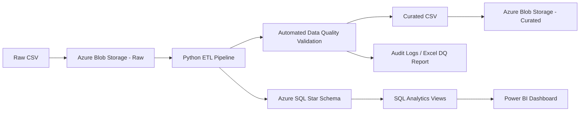

# Cloud Supply Chain Analytics & Automated Data Quality Pipeline

An end-to-end data analytics portfolio project that ingests supply-chain data from Azure Blob Storage, validates and transforms it with Python, loads a star-schema warehouse in Azure SQL, builds reusable SQL analytics views, and presents business insights in Power BI.

## Project Overview

This project analyzes the **DataCo SMART Supply Chain** dataset and focuses on four business questions:

1. Which shipping modes are driving SLA failures?
2. Which products generate strong revenue but weak profitability?
3. How concentrated is revenue across the product portfolio?
4. How do sales and profit change over time?

The raw dataset contains:

- **180,519 order-line records**
- **65,752 unique orders**
- **53 source columns**
- Customer, product, geography, shipping, sales, discount, profit, and delivery information

The final solution combines **Python, Azure Blob Storage, Azure SQL, SQL analytics, data quality controls, and Power BI**.

---

## Architecture



---

## Technology Stack

- **Python**: pandas, NumPy, pyodbc, python-dotenv
- **Azure**: Blob Storage, Azure SQL Database, Azure CLI authentication
- **SQL**: star-schema modeling, CTEs, window functions, analytics views
- **Power BI**: semantic model, DAX measures, KPI cards, trend analysis, Pareto analysis
- **Excel**: automated data-quality report output
- **Git / GitHub**: version control and project documentation

---

## ETL & Data Quality Pipeline

The Python pipeline performs:

- Cloud extraction from Azure Blob Storage
- Column standardization and type conversion
- PII reduction for downstream analytics
- Derived shipping and profitability fields
- Automated validation rules
- Curated dataset output
- Azure upload
- Audit logging
- Excel data-quality reporting

### Automated Data Quality Rules

The pipeline currently validates **10 rules**, all passing on the full dataset:

| Rule | Validation |
|---|---|
| DQ001 | Order item primary key is unique and non-null |
| DQ002 | Required date fields are valid |
| DQ003 | Calculated shipping days reconcile with source values |
| DQ004 | Derived SLA breach flag matches source delivery behavior |
| DQ005 | Quantity is positive |
| DQ006 | Unit price is positive |
| DQ007 | Sales reconcile to quantity × unit price |
| DQ008 | Effective discount rate is between 0 and 1 |
| DQ009 | Order item total reconciles to sales less discount |
| DQ010 | Profit value is present |

**Result: 10 / 10 validation rules passed across 180,519 records.**

---

## Data Modeling

The Azure SQL warehouse uses a star schema.

### Dimensions

- `dw.dim_date`
- `dw.dim_customer`
- `dw.dim_product`
- `dw.dim_geography`
- `dw.dim_shipping`

### Fact Table

- `dw.fact_order_item`

Fact grain:

> **One row per order line item**

Warehouse validation:

- **180,519 fact rows**
- **180,519 unique order items**
- **65,752 unique orders**

Customer PII is intentionally excluded from the analytics model.

---

## SQL Analytics Views

Four reusable analytics views support reporting:

- `dw.vw_monthly_kpis`
- `dw.vw_product_profitability`
- `dw.vw_product_sales_pareto`
- `dw.vw_shipping_performance`

The views use SQL aggregation, CTEs, ranking, and window functions to prepare business-ready metrics for Power BI.

---

## Key Business Insights

### 1. Premium shipping modes have the weakest SLA reliability

Shipping performance varies much more by shipping mode than by geography.

| Shipping Mode | SLA Breach Rate | Avg Actual Days | Avg Scheduled Days |
|---|---:|---:|---:|
| First Class | **95.32%** | 2.0 | 1.0 |
| Second Class | **76.63%** | 4.0 | 2.0 |
| Same Day | **45.74%** | 0.5 | 0.0 |
| Standard Class | **38.07%** | 4.0 | 4.0 |

Cancellation rates remain relatively low and similar across shipping modes, indicating that overly aggressive delivery commitments are a more important driver of SLA underperformance.

### 2. Revenue does not always translate into profitability

`SOLE E35 Elliptical` generated approximately **$26.4K in net sales** but produced an overall **-$965 loss**.

Only 3 of 15 line items were loss-making, but those 3 transactions generated approximately **-$6.47K** in losses, erasing more than **$5.5K** of profit from the remaining transactions.

The loss pattern was not consistently explained by discount rate, indicating a need for deeper investigation into product-level unit economics or source-system cost logic.

### 3. Revenue is highly concentrated

Only **8 of 118 products (6.8%)** were required to exceed **80% of total net sales**.

- Core contributors: **84.73%** of net sales
- Long tail: **15.27%** of net sales

This highlights significant revenue concentration risk and the importance of monitoring inventory, fulfillment, and profitability for a small number of core SKUs.

### 4. Sales and profit do not always move together

Monthly revenue and profit occasionally diverge.

Examples:

- **October 2015**: Net sales increased ~3.1% MoM while profit declined ~10.3%.
- **September 2016**: Net sales declined ~4.5% while profit increased ~11.4%.
- **January 2018**: Orders stayed essentially flat versus December 2017, but net sales fell ~34.2% and profit fell ~48.6%, driven by lower average sales and profit per order.

---

## Power BI Dashboard

### Page 1 — Supply Chain Executive Overview

Current visuals include:

- Total Net Sales
- Total Profit
- Total Orders
- SLA Breach Rate
- Loss-Making Rate
- Monthly Net Sales & Profit Trend
- Net Sales Concentration
- SLA Breach Rate by Shipping Mode
- Year slicer

### Page 2 — Shipping & Delivery Performance

Current visuals include:

- Overall SLA Breach Rate
- Average Actual Shipping Days
- Average Scheduled Shipping Days
- Cancellation Rate
- SLA Breach Rate by Shipping Mode
- Actual vs Scheduled Shipping Days
- Delivery Status Distribution by Shipping Mode
- SLA Breach Rate by Shipping Mode & Market heatmap

### Page 3 — Product & Profitability Analysis

Planned / in progress:

- Product revenue vs profit scatter plot
- Lowest-profit products
- Product revenue Pareto analysis
- Product profitability watchlist

### Page 4 — Data Quality

Planned:

- Pipeline validation summary
- 10/10 DQ rules
- Processed row count
- Pipeline status and audit metrics

---

## Repository Structure

```text
cloud-supply-chain-analytics/
├── config/
├── data/
│   ├── raw/
│   ├── processed/
│   └── rejected/
├── notebooks/
│   └── 01_data_profiling.ipynb
├── powerbi/
│   └── supply_chain_analytics_dashboard.pbix
├── reports/
│   ├── data_quality_summary.csv
│   ├── data_quality_report.xlsx
│   └── pipeline_run_log.csv
├── sql/
│   ├── 01_create_star_schema.sql
│   └── 02_create_analytics_views.sql
├── src/
│   ├── config.py
│   ├── extract.py
│   ├── transform.py
│   ├── validate.py
│   ├── load.py
│   ├── audit.py
│   ├── report.py
│   ├── pipeline.py
│   ├── azure_storage.py
│   ├── sql_connection.py
│   ├── run_sql_file.py
│   ├── check_warehouse.py
│   └── build_warehouse.py
├── tests/
├── .env.example
├── .gitignore
├── README.md
└── requirements.txt
```

---

## Running the Project

### 1. Create and activate a virtual environment

```powershell
python -m venv .venv
.venv\Scripts\Activate.ps1
pip install -r requirements.txt
```

### 2. Configure environment variables

Create a `.env` file based on `.env.example`.

Example:

```text
AZURE_SQL_SERVER=your-server.database.windows.net
AZURE_SQL_DATABASE=your-database
AZURE_SQL_USERNAME=your-username
AZURE_SQL_PASSWORD=your-password
```

Do **not** commit `.env` to GitHub.

### 3. Run the cloud ETL pipeline

```powershell
python src/pipeline.py
```

### 4. Build the Azure SQL warehouse

```powershell
python src/run_sql_file.py sql/01_create_star_schema.sql
python src/build_warehouse.py
```

> `01_create_star_schema.sql` rebuilds the schema and clears existing warehouse tables. Run it only when a full warehouse reset is intended.

### 5. Create analytics views

```powershell
python src/run_sql_file.py sql/02_create_analytics_views.sql
```

### 6. Validate warehouse row counts

```powershell
python src/check_warehouse.py
```

---

## Data Governance Notes

- Customer PII is excluded from the analytical warehouse where it is not required.
- Secrets are loaded from environment variables and are not hard-coded.
- Azure Blob containers are private.
- Data-quality rules are executed before curated outputs are published.

---

## Future Improvements

- Complete Product & Profitability and Data Quality Power BI pages
- Add automated rejected-row handling
- Add GitHub Actions or scheduled pipeline execution
- Add automated tests for transformation and validation functions
- Add deployment-ready Power BI screenshots to the repository
- Optionally migrate or replicate the analytics layer to BigQuery for cloud-platform comparison

---

## Resume-Friendly Summary

> Built an end-to-end cloud supply chain analytics pipeline processing **180K+ order-line records** using Python, Azure Blob Storage, and Azure SQL; implemented **10 automated data-quality checks**, designed a star-schema warehouse and SQL analytics views, and developed Power BI dashboards identifying **95% First Class SLA breach rates**, product-level profitability anomalies, and **84.7% revenue concentration across only 8 products**.

---

## Author

Built as a portfolio project focused on data analytics, data quality, cloud data workflows, SQL modeling, and business intelligence.
